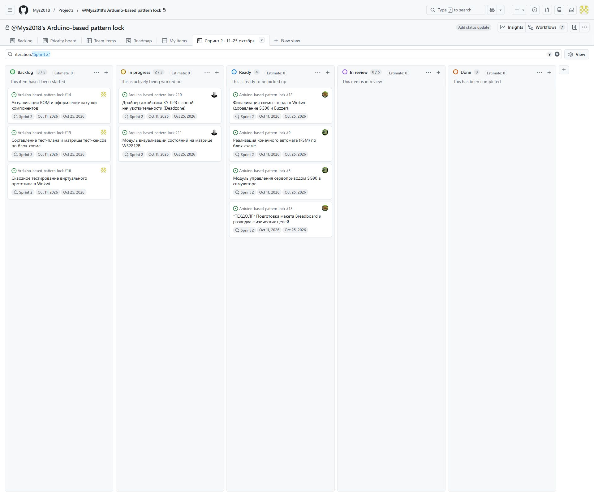

# Второй спринт — графический замок

Период по уточнению команды: **11–25 октября 2026 года**. Ответственный за оформление: аналитик kahmarr.

## Цель команды

Подготовить виртуальный прототип: ввод ключа, проверка, индикация, SG90 и блокировка после ошибок. Подготовить список деталей физического стенда и тест-план; выполнить доступные испытания и записать ошибки. Это цель спринта, а не утверждение о её полном достижении.

[Доска GitHub](https://github.com/users/Mys2018/projects/1/views/7). На каждой карточке указаны Start date 11 октября и Target date 25 октября. Внутренний двухнедельный интервал Iteration заканчивается 24 октября; отдельный Target date отражает названный командой срок 25 октября.

## Задачи и измеримый результат

| Задача | Результат для проверки | Состояние на снимке до работ аналитика |
|---|---|---|
| #8 SG90 | Открытие до 90°, закрытие до 0°, удержание без остановки цикла | Ready |
| #9 Автомат состояний | Все переходы состояния и таймеры проверяемы по журналу | Ready |
| #10 KY-023 | Направления, нейтраль и один шаг на отклонение | In progress |
| #11 WS2812B | Матрица показывает ввод, успех и ошибку | In progress |
| #12 Схема Wokwi | Совместимые схема, код и библиотеки запускаются вместе | Ready |
| #13 Физическая сборка — техдолг | Собранный стенд, проверенное питание и соединения | Ready; физическое выполнение не подтверждено |
| #14 BOM/закупка | Список деталей и подтверждения заказов/выдачи | Backlog; подготовлен список, закупка не подтверждена |
| #15 Тест-план | docs/tests.md: шаги, ожидаемые и фактические результаты | Backlog до публикации плана |
| #16 Проверка прототипа | Отчёт о прогонах, доказательства, заведённые ошибки | Backlog до текущего прогона |

## Как читать доску

Backlog — к выполнению; In progress — в работе; Ready — результат подготовлен к следующему этапу; In review — на проверке; Done — готово. Пять колонок включают требуемые три этапа. Ready не означает, что задача принята или физический стенд собран.

Снимок сделан **26 октября**, до публикации результатов аналитика. Done на нём пуст. Это реальное состояние доски на момент снимка; он не является историческим снимком старта 11 октября. Требование задания о пустом Done на старте этим задним числом не доказывается.

## Итог работы аналитика 26 октября

Подготовлены 26 тест-кейсов, обновлён физический BOM, выполнен базовый прогон Wokwi и дополнительные проверки логики на ПК. Выявлены B001 (10 секунд вместо 30) и B002 (сброс ключа через Serial без проверки старого). Полная приёмка и закупка не завершены. Подробности: [tests.md](tests.md), [test-report.md](test-report.md), [bom.md](bom.md).
