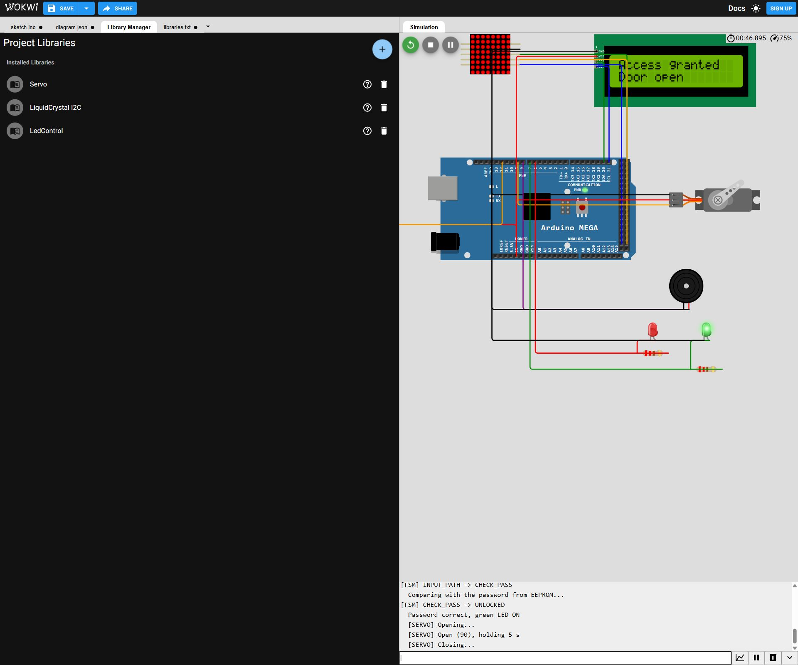
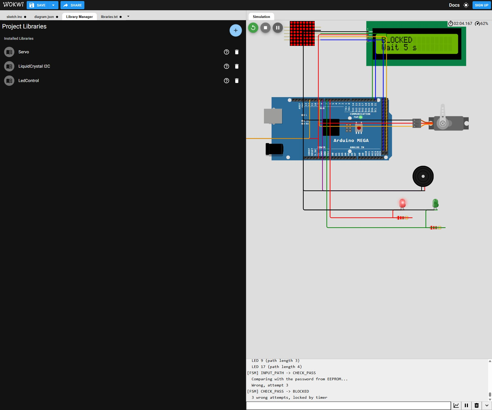

# Отчёт о проверке виртуального замка

Аналитик kahmarr, 26.10.2026. Связано с #16.

## Что проверено

В Wokwi успешно скомпилирован и запущен неизменённый скетч graphic_lock_wokwi.txt из #9. Для воспроизведения аналитик собрал отдельную виртуальную схему по выводам кода: Mega, MAX7219 8×8 (DIN51/CLK52/CS53), LCD I2C, KY-023, SG90 D9, зуммер D8 и индикаторы. Файл qa-diagram.json — именно эта контрольная схема, а не подтверждение готовности схемы команды из #12.

На рисунке #12 показана обычная матрица 1588SA с D22–D37. Она не соответствует LedControl/MAX7219 в скетче. Это необходимо согласовать при интеграции. По подтверждению команды Mega/8×8 является только вариантом симулятора; физическая версия остаётся Uno/Nano + WS2812B 4×4.

Проверены запись первого ключа P, принятие P, зелёная индикация и SG90 90°, автоматическое закрытие, ошибки 1/2/3, переход в BLOCKED, возврат после тайм-аута и сценарий стирания/замены ключа через Serial. Наблюдения сохранены в wokwi_serial.txt и снимках. Ввод пути в этом прогоне выполнялся через Serial, не через движения мышью по виртуальному джойстику.

## Дополнительная проверка логики на ПК

Исходный код включён в тестовую программу C++17 с заглушками времени, Serial, EEPROM и периферии. Из 18 принятых проверок полного скетча 16 прошли, 2 выявили расхождения. Два отдельных теста модуля SG90 из sketch.txt прошли. Это не 20 полных сценариев Wokwi и не проверка реальной электроники. Детали — host_results.json и servo_host_results.json; исходники проверок — qa-checks.zip. Недостоверная проба смещённого центра исключена из итогов: из-за граничной точки она не проверяла нужное условие.

## Выявленные проблемы

- **B001:** после трёх ошибок блокировка 10 секунд, тогда как #15 требует 30. В коде BLOCK_MS=10000, на LCD Wait 10s; ПК-модель измерила 10000 мс.
- **B002:** команда r в CHOOSE_START стирает сохранённый ключ без проверки старого. После записи Q замок открывается Q. Для пользовательской смены ключа нужна авторизация; если команда оставляет сервисную команду, необходимо явно ограничить и описать этот режим. Проверка относится к доступному Serial-интерфейсу прототипа.

## Что осталось

Полный прогон всех направлений/границ и нейтрали виртуального стика, дребезг, последовательности TC-15/24, проверка исправлений B001/B002. Также требуется решение о выборе первой точки без Serial, автокалибровке и переносе на физическую 4×4. Отключение питания во время перезаписи EEPROM, питание и механика реального стенда не проверялись. #16 пока не считается полностью завершённой.

## Версии и воспроизведение

- Полный скетч SHA256: `60CEDADA2BCD1739E45821B93EB65F0E8A5F31E20F34F385C6EC0F3521AACE74`. [Источник #9](https://github.com/Mys2018/Arduino-based-pattern-lock/issues/9#issuecomment-6399289981).
- Модуль SG90 SHA256: `DD91C99A82D5D9B7E7C35AC79ADDD2DC9BFC3147263A603F3F559B1174B88DCD`. [Источник #8](https://github.com/Mys2018/Arduino-based-pattern-lock/issues/8#issuecomment-6343913171).
- Контрольная схема: qa-diagram.json, библиотеки: qa-libraries.txt. Wokwi запускался как несохранённый проект; постоянной ссылки на этот прогон нет. Все файлы для воспроизведения приложены.

